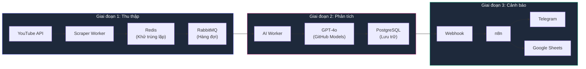
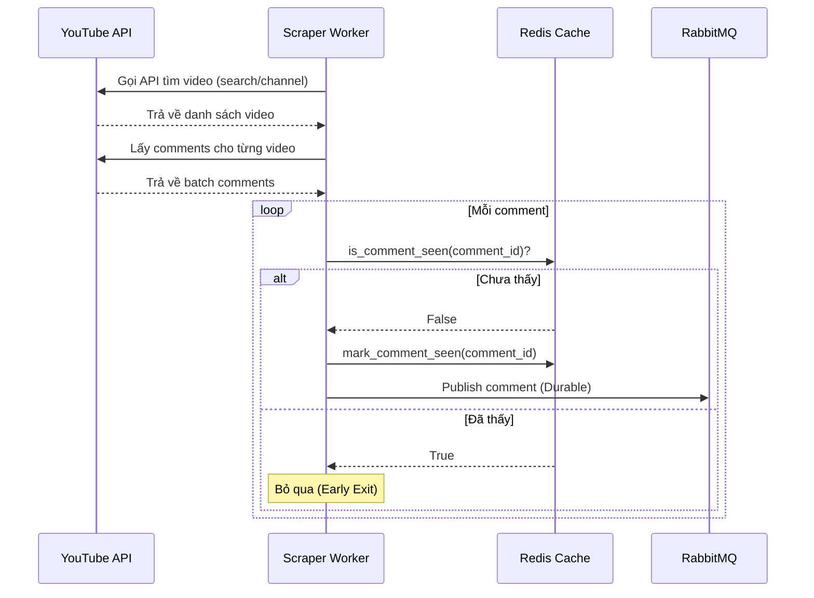
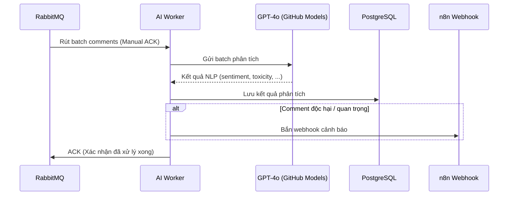
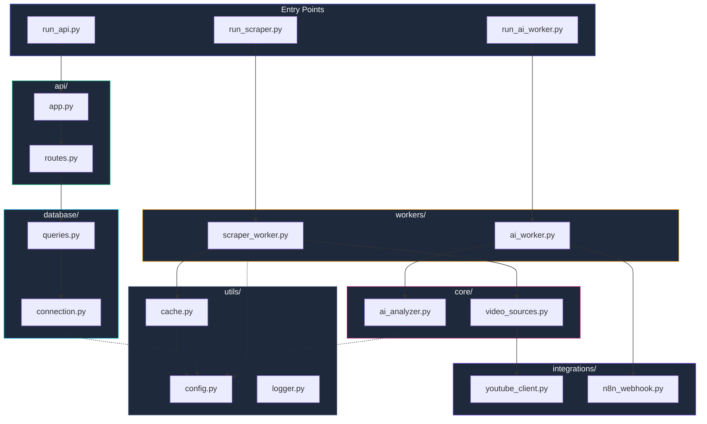

# 🏗️ Kiến Trúc Hệ Thống — YouTube AI Auto Ops

## Tổng Quan

Hệ thống YouTube AI Auto Ops là một **Data Pipeline cấp độ doanh nghiệp** được thiết kế theo kiến trúc Microservices. Mục tiêu: tự động thu thập bình luận YouTube, phân tích bằng AI (GPT-4o), lưu trữ kết quả vào PostgreSQL, và cảnh báo qua n8n webhook (Telegram + Google Sheets).

---

## Luồng Dữ Liệu (Data Flow)

Dữ liệu đi qua **3 Giai đoạn (Phases)** độc lập, tách rời hoàn toàn:

---

## Chi Tiết Từng Giai Đoạn

### Giai đoạn 1: Producer (Scraper Worker)

**Đặc điểm kỹ thuật:**
- **Smart Pagination**: Duyệt qua nhiều trang comment, dừng sớm khi gặp comment cũ
- **Early Exit**: Khi Redis báo comment đã xử lý → dừng lấy thêm trang mới
- **Token Rotation**: Tự động chuyển YouTube API key khi bị Rate Limit

### Giai đoạn 2: Consumer (AI Worker)

**Đặc điểm kỹ thuật:**
- **Batch Processing**: Xử lý nhiều comment trong 1 lần gọi API, tiết kiệm chi phí
- **Manual ACK**: Chỉ xác nhận với RabbitMQ SAU KHI xử lý thành công → không mất dữ liệu
- **Token Rotation**: Xoay vòng GitHub tokens để tránh Rate Limit GPT-4o

### Giai đoạn 3: Automation (n8n)

- Nhận webhook từ AI Worker khi phát hiện comment quan trọng
- Ghi log chi tiết vào Google Sheets (lưu trữ lâu dài)
- Bắn cảnh báo khẩn cấp tới Telegram Bot

---

## Kiến Trúc Module

---

## Công Nghệ Sử Dụng (Tech Stack)

| Thành phần | Công nghệ | Mục đích |
|---|---|---|
| Ngôn ngữ | Python 3.11+ | Logic chính toàn bộ hệ thống |
| Message Queue | RabbitMQ | Hàng đợi phân tán, đảm bảo không mất dữ liệu |
| Cache | Redis | Khử trùng lặp tốc độ cao (In-Memory) |
| Database | PostgreSQL 15 | Lưu trữ vĩnh viễn kết quả phân tích |
| AI/NLP | OpenAI GPT-4o (qua GitHub Models) | Phân tích sentiment, toxicity, sarcasm |
| Web Framework | FastAPI + Uvicorn | REST API và phục vụ giao diện Command Center |
| Automation | n8n | Workflow tự động: Google Sheets + Telegram |
| Dashboard | Metabase | BI dashboard trực quan |
| DevOps | Docker Compose | Orchestration toàn bộ hạ tầng |

---

## Quyết Định Thiết Kế Quan Trọng

### Tại sao dùng RabbitMQ thay vì gọi AI trực tiếp?
- **Kháng lỗi (Fault Tolerance)**: Nếu AI Worker crash, message vẫn an toàn trong queue
- **Mở rộng (Scalability)**: Có thể chạy nhiều AI Worker song song
- **Tách rời (Decoupling)**: Scraper và AI Worker hoạt động độc lập

### Tại sao dùng Redis cho Deduplication?
- **Tốc độ**: Kiểm tra trùng lặp chỉ mất ~1ms (In-Memory)
- **TTL tự động**: Comment tự hết hạn sau thời gian, giải phóng bộ nhớ
- **Atomic operations**: An toàn khi chạy nhiều Scraper Worker đồng thời

### Tại sao dùng GitHub Models thay vì OpenAI trực tiếp?
- **Miễn phí / Chi phí thấp**: GitHub Models có free tier
- **Token Rotation**: Dùng nhiều token xoay vòng để tránh Rate Limit
- **Cùng model**: Vẫn dùng GPT-4o, chất lượng tương đương
